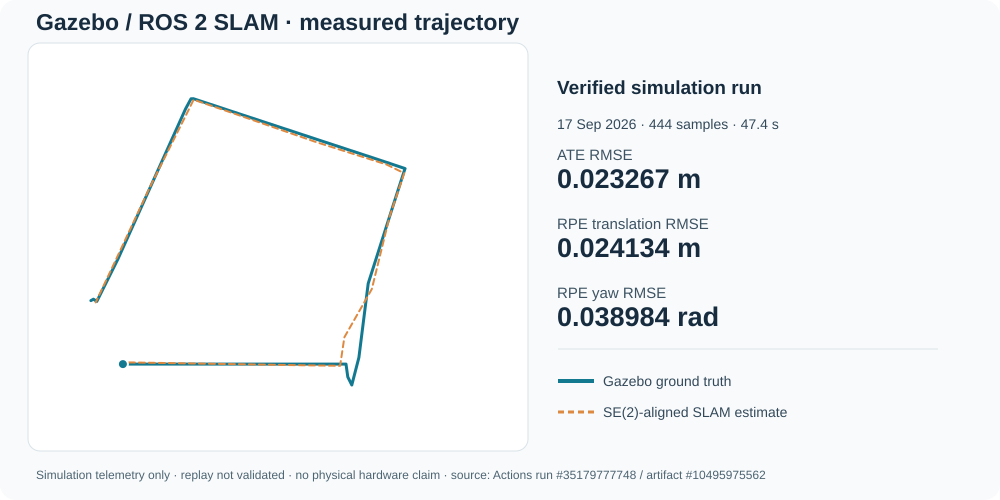

# Verified Gazebo simulation benchmark — 17 September 2026

**Evidence classification:** successful **simulation runtime capture** and archived benchmark results. **Not** a physical robot test, validated rosbag replay, or independent rerun of the present `main` commit.

## Provenance

- Repository: [VivekVRobo/slam-robot-ros2](https://github.com/VivekVRobo/slam-robot-ros2)
- Benchmark source commit: [`ec9ceb2e39ae3527dee93e667fa92b848d91540f`](https://github.com/VivekVRobo/slam-robot-ros2/commit/ec9ceb2e39ae3527dee93e667fa92b848d91540f)
- Completed [Gazebo Benchmark workflow run #35179777748](https://github.com/VivekVRobo/slam-robot-ros2/actions/runs/35179777748): **success**, 17 September 2026
- [Evidence artifact #10495975562](https://github.com/VivekVRobo/slam-robot-ros2/actions/runs/35179777748/artifacts/10495975562): `gazebo-slam-benchmark-evidence` (2,092,936 bytes; GitHub artifact download may require access)
- Artifact ZIP SHA-256 reported by Actions: `e88bdece51532afc3dfacfde8007a67bb3ecf04070611fb63fad12bffd19be57`
- Evidence run: `2026-09-17T11-52-46Z_gazebo_loop_square_ec9ceb2e`; scenario `gazebo_loop_square`
- Runtime host as captured: native Ubuntu 26.04.1 Linux, ROS 2 Lyrical, Gazebo 10.5.0, headless; benchmark duration approximately 52 seconds.
- Inputs include `/scan`, `/odom`, `/ground_truth/odom`, `/tf`, `/tf_static`, `/map`, `/clock`; simulator ground truth is separate from wheel odometry.

## Actual measured outputs

| Metric | Archived value |
| --- | ---: |
| Trajectory samples | 444 |
| Evaluated trajectory duration | 47.4 s |
| Absolute trajectory error (ATE) RMSE | 0.0232671414 m |
| Relative pose error translation RMSE | 0.0241340961 m |
| Relative pose error yaw RMSE | 0.0389840746 rad |
| Benchmark threshold checks | PASS |
| Evidence manifest validation | PASS |

**Figure provenance:** The plotted polylines were generated from the archived `runtime/trajectory.csv` (every eighth sample for legibility, including the final sample). The estimated path uses the archived rigid SE(2) transform (yaw -0.0161787104 rad, translation -3.4141618525 m / -2.7934335768 m). Recomputing the Euclidean aligned error over all 444 samples gives ATE RMSE 0.0232671414 m, matching the archived `runtime/trajectory-metrics.json`. The figure is a **telemetry visualization**, not a Gazebo video or a physical-robot photo.

## Reproduction and inspection

1. Check out source commit `ec9ceb2e39ae3527dee93e667fa92b848d91540f`, rather than assuming present `main` was executed.
2. Follow [the benchmark runbook](../../docs/BENCHMARK_EVIDENCE_RUNBOOK.md), capturing the ROS/Gazebo environment.
3. Run `bash scripts/run_simulation_evidence_campaign.sh` in the documented compatible environment.
4. Inspect `runtime/trajectory.csv`, `runtime/trajectory-metrics.json`, `runtime/benchmark-gate.json`, `runtime/map.pgm`, `runtime/runtime-topics.txt`, manifest file hashes, the rosbag MCAP and logs in the downloaded artifact.
5. For regression validation, separately execute `bash scripts/replay_benchmark.sh artifacts/bags/gazebo_loop_square` (adjust bag path to extracted bundle) and record the resulting command, exit code and metrics.

## Explicit limitations

- `replay.md` in the archive states **rosbag replay was not yet validated**. Do not advertise a replay PASS.
- The successful source commit predates later changes to the public README/artwork. A fresh benchmark on latest `main` remains to be verified.
- This is one successful CI-host simulation run, not an independently reproduced benchmark across hosts, seeds or robots.
- No authentic Gazebo screen recording is present in this evidence package. The chart above is derived from the actual recorded trajectory.
- No physical LiDAR, wheel encoder, localization accuracy, actuator or other hardware claim follows from this run.

Evidence is kept inspectable and narrower than marketing claims; further results should reference their own run IDs and commit hashes.
